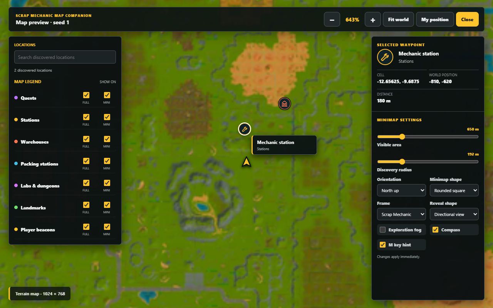

<h1 align="center">Scrap Mechanic Save Editor</h1>

<p align="center">Edit your saves. Explore your world. Keep your progress backed up.</p>

<p align="center">
  <a href="https://github.com/MrBoxik/Scrap-Mechanic-Save-Editor/releases/latest"><b>Download for Windows</b></a>
  &nbsp; | &nbsp;
  <a href="docs/USER_GUIDE.md">User guide</a>
  &nbsp; | &nbsp;
  <a href="https://github.com/MrBoxik/Scrap-Mechanic-Save-Editor/issues">Report a problem</a>
</p>

An offline desktop save editor with a 2D/3D world viewer and a live Map Companion
for Survival. No account, save upload, or Python installation is needed to use
the Windows release.

## Download

1. Open the [latest release](https://github.com/MrBoxik/Scrap-Mechanic-Save-Editor/releases/latest).
2. Download `ScrapMechanicSaveEditor-4.22.1-Windows-x64.zip` and extract **all** its contents.
3. Open `ScrapMechanicSaveEditor.exe` inside the extracted folder.

Keep `_internal` beside the EXE. This portable layout starts faster than a
single-file executable that unpacks itself on every launch. GitHub's **Source
code** downloads are for developers, not the ready-to-run app.

**Requirements:** Windows 10/11, 64-bit, and a Steam installation of Scrap
Mechanic. Steam and the game can be installed on different drives.

> [!IMPORTANT]
> Close Scrap Mechanic before editing saves or character profiles. Keep your
> own backup too. The editor makes timestamped backups outside the game's save
> folders, but no save editor can guarantee recovery from every problem.

## Features

| Area | What you can do |
| --- | --- |
| Inventory | Edit backpack, hotbar, and recognized containers; search items, change quantities, and drag slots. |
| Player and world | Change health, oxygen, food perks, position, day/time, difficulty, and supported world settings. |
| Progress | Edit supported quests, recipes, logbook entries, unlocks, raids, and world services. |
| Character | Edit global clothing unlocks, appearance, and equipment with profile backups. |
| Blueprints | Browse local creations, edit metadata, duplicate, export, and import ZIPs. |
| World map | Search destinations, inspect tile artwork, build an HD 2D map, and explore the generated world in 3D. |
| Map Companion | Use a live minimap and M-key world map with persistent exploration, waypoint details, and settings you can change in game. |
| Backups | Keep edited copies, browse version history, and restore with a recovery backup. |

Survival has the widest support. Creative/Sandbox and Custom Game saves expose
only the capabilities actually present in their database. **Map Companion is
Survival-only.**

## Map Companion

Choose **Launch with Map Companion** in the editor. It starts the game through
Steam and opens the minimap when a Survival world loads. No game-file patch,
developer mode, or Workshop mod is required.

- Press **M** for the full map and **Esc** to close it.
- Choose a circle or rounded-square minimap, orientation, zoom, and reveal shape.
- Exploration persists per world; discovered destinations remain available.
- Use the terrain map immediately, or build an HD map in the editor first.
- Preview settings in the editor before launching the game.

<p align="center">
  
</p>

The companion reads live position/facing from the game process **read-only**.
It parses private save snapshots and never writes to the active game database.
See the [user guide](docs/USER_GUIDE.md) and [privacy notes](docs/PRIVACY.md).

## Feedback and Support

Found a bug? Include your editor version, game version, steps to reproduce, and
a screenshot where useful. Read the [support guide](docs/SUPPORT.md) before
sharing logs or saves; they can contain personal information.

- [GitHub issues](https://github.com/MrBoxik/Scrap-Mechanic-Save-Editor/issues)
- [Discord](https://discord.com/users/638802769393745950)
- [Buy me a coffee](https://www.buymeacoffee.com/mrboxik)

This is an unsigned community application. Review its source and release
checksums before running it; do not disable antivirus protections to use it.

## Source and Building

The application, assets, tests, and build tools live in [`app/`](app/). Guides,
release notes, and validation reports live in [`docs/`](docs/).

```powershell
cd app
python -m pip install -r requirements-desktop.txt
python run_desktop_editor.py
```

Python 3.11+ is required for source use. See [development and build instructions](docs/DEVELOPMENT.md)
and [contributing](docs/CONTRIBUTING.md). Ready-made binaries belong in Releases,
not the source tree.

## License

By **MrBoxik**. Personal and non-commercial use with attribution is allowed
under the [Custom Non-Commercial License](LICENSE). Commercial use requires
prior written permission.

Scrap Mechanic and its artwork belong to Axolot Games and their respective
owners. This unofficial project is not affiliated with or endorsed by Axolot
Games. See [third-party notices](docs/THIRD_PARTY_NOTICES.md).
